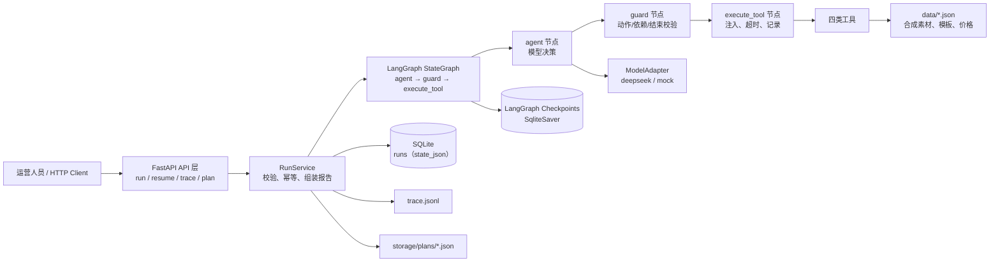
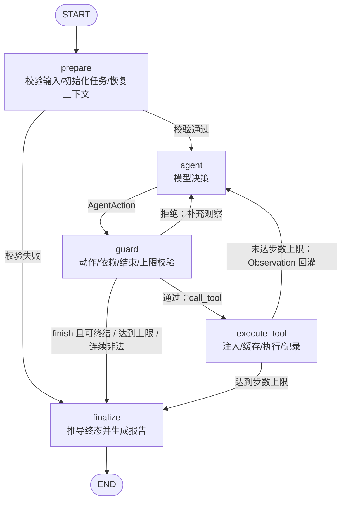

# 内容任务规划 Agent · 项目设计文档

| 项目 | 内容 |
|---|---|
| 文档版本 | v1.1 |
| 日期 | 2026-10-28 |
| 依据 | `requirement.md` |
| 状态 | 已实现并通过 Mock 验收及 DeepSeek `deepseek-flash` 真实调用验证 |
| 适用对象 | 实现、测试、评审、交付文档编写 |

> 实现与本文的已知偏差：运行时仅创建 `runs` 表保存状态与响应，步骤嵌在 `state_json`，方案写入 JSON 文件；`tool_cache` 与独立 `steps/plans/cache` 表属于后续扩展。续跑使用应用层状态快照而非检查点原地恢复。详见 `docs/02-solution.md` 第 10 节与 `docs/03-evaluation.md` 第 5.2 节。

---

## 1. 设计摘要

本项目实现一个面向运营人员的内容任务规划 Agent。用户输入 **主题、预算、截止时间**，Agent 在预算与截止时间约束内，通过四类工具完成以下交付：

1. 检索可用素材；
2. 生成活动脚本；
3. 估算并复算活动成本与工期；
4. 保存最终活动方案。

Agent 采用 **LangGraph 自定义状态图** 承载“模型选择动作 → 执行工具 → 观察结果 → 模型调整或结束”的完整循环。模型只负责语义决策，不直接写状态；工具执行器负责记录真实返回；终结节点根据证据推导终态，保证“失败步骤不会被记为成功”。

离线 Mock 入口默认可用，仅用于验证流程、状态机、异常处理和可复现性，**不证明真实模型的决策效果**。真实模型通过可配置的 OpenAI-compatible 适配器接入。

核心设计原则：

- **决策与事实分离**：模型选择动作；代码执行工具、校验依赖、记录状态。
- **成本可复算**：费用全部来自 `data/pricing.json`，使用 `Decimal` 计算并带规则版本号。
- **状态可审计**：每一步的动作、参数、工具返回摘要、决策依据均落入 Trace。
- **异常不伪装**：超预算、工具错误、部分成功、达到上限均形成明确观察或未完成原因。
- **重复执行可解释**：幂等键、内容寻址保存、状态复用与续跑机制避免矛盾状态。
- **范围克制**：不做界面、线上部署、多 Agent、生产级 Runtime。

---

## 2. 需求映射

| requirement.md 要求 | 设计落点 |
|---|---|
| 输入主题、预算、截止时间 | `RunRequest`；缺失时不调用模型和工具，直接返回 `incomplete` |
| 四类工具 | `search_materials`、`generate_script`、`estimate_cost`、`save_plan` |
| 正常终态：计划、步骤状态、工具结果、费用合计、已保存方案 | `FinalReport` 固定字段，见 §10.3 |
| 异常终态：未完成原因与缺口 | `IncompleteReport`，含 `code`、`gap`、`completed_steps`、`next_actions` |
| 完整 ReAct 循环 | `agent → guard → execute_tool → observation → agent`，LangGraph 条件边回环 |
| 三类观察：成本超限、工具错误、部分成功 | 统一 `Observation`；Mock 与真实模型均基于观察决策 |
| 调整方式：调整计划、替代方案、停止 | `reason_code` 驱动；动作由模型输出，代码校验 |
| 保留已成功步骤 | Task 的 `branch=superseded` 与工具结果缓存；不删除历史 |
| 失败步骤不记为成功 | 只有执行器能写 `succeeded`，且由真实工具返回决定 |
| 步数/工具调用上限 | `max_steps=12`、`max_tool_calls=8`，服务端硬上限；超限明确未完成 |
| 两条执行路径记录 | `examples/` 实际生成 9 组场景、11 份报告与 10 份 Trace，见 §14 |
| 场景 1：10/12/8 | 标准方案 12 超预算，改选轻量方案 8，再估算并保存，见 §11.2 |
| 场景 2：无可行方案 | 全部候选评估后停止，返回最低成本与预算缺口 |
| 场景 3：工具失败 | 注入失败，观察后改选方案或停止，失败步骤保留为 `failed` |
| 场景 4：缺预算/截止时间 | 输入校验阶段拦截，不猜测 |
| 场景 5：重复执行 | `Idempotency-Key` 精确复用；无键时独立运行且保存去重 |
| 场景 6：失败步骤续跑（加分） | `POST /v1/runs/{run_id}/resume`，复用已成功步骤结果，从失败点继续 |
| LangGraph 版本、职责、默认行为修改 | 见 §5 |
| HTTP API、启动命令、请求示例 | 见 §10 |
| 真实模型 + 离线 Mock | 见 §5、§8.6 |
| 不提交密钥/隐私数据 | 见 §16 |

---

## 3. 用户与使用方式

### 3.1 用户

运营人员，关注：

- 在预算内完成活动方案；
- 明确知道每个步骤是否完成；
- 失败时知道“差多少”“卡在哪”“还能怎么做”；
- 同一需求重复提交时，不产生重复方案或互相矛盾的状态。

### 3.2 典型交互

```text
运营人员 → POST /v1/runs（主题、预算、截止时间）
        ← 完整终态报告（计划、步骤、工具结果、成本、方案）
```

系统不要求用户逐步干预。Agent 在一次运行内完成规划、工具调用和调整。运营人员可通过 `GET /v1/runs/{id}/trace` 查看决策轨迹。

### 3.3 成功标准

- A-01 至 A-08 验收点全部有可执行测试与示例；
- 正常终态能给出可复算的费用合计与已保存方案；
- 未完成终态必须说明缺口，不能只有错误字符串；
- 失败、部分成功、被替代的步骤状态真实可追溯；
- 同一输入/同一运行重复执行结果一致或明确可解释；
- 仓库启动、测试、示例生成均可按 README 复现；
- 不依赖真实付费模型或真实外部素材即可完成演示。

---

## 4. 总体架构



### 4.1 分层职责

| 层 | 职责 | 不负责 |
|---|---|---|
| API 层 | 接收 HTTP、Pydantic 校验、返回统一 JSON | 业务决策、成本计算 |
| RunService | 幂等、创建运行、调用图、持久化报告、续跑编排 | 决定下一步工具 |
| LangGraph 图 | 状态流转、条件路由、循环、检查点 | 费用数学、工具内部逻辑 |
| agent 节点 | 组装上下文、调用模型、写入决策记录 | 校验工具依赖、直接改步骤状态、直接写方案 |
| guard 节点 | 校验动作 schema、工具依赖、结束条件、上限 | 执行工具、修改工具结果 |
| execute_tool 节点 | 失败注入、缓存、执行、记录真实结果 | 决定是否重试或换方案 |
| 工具层 | 检索、生成、估算、保存的确定性实现 | 自主决策 |
| 模型适配层 | 真实模型结构化输出 / Mock 规则策略 | 修改业务状态 |
| 存储层 | 运行、步骤、方案、缓存、检查点 | 判断业务成功 |

关键边界：**模型不能把步骤标记为成功，也不能自己填写费用合计。** 模型只能提出 `call_tool` 或 `finish`；成功与否由工具返回和执行器共同决定。

---

## 5. 技术选型

### 5.1 版本清单

| 组件 | 版本 | 用途 |
|---|---|---|
| Python | 3.10.11 | 与当前 `.venv` 一致；类型语法使用 `X | None` 需 3.10+ |
| LangGraph | **1.2.18** | 状态图、条件边、循环、检查点 |
| langgraph-checkpoint-sqlite | 3.1.2 | LangGraph 运行检查点持久化 |
| langchain-core | 1.7.0 | 消息与结构化输出基础类型 |
| langchain-openai | 1.7.3 | 真实模型适配（OpenAI-compatible） |
| FastAPI | 0.162.0 | HTTP API、请求/响应模型 |
| Uvicorn | 0.54.0 | ASGI 运行 |
| Pydantic | 2.14.1 | 请求、动作、工具结果、报告校验 |
| SQLite | Python 标准库 | 运行记录、步骤、方案、缓存 |
| pytest | 9.2.0 | 单元、集成、场景测试 |
| httpx | 0.28.1 | API 测试与示例脚本 |
| `decimal` | 标准库 | 成本精确计算，避免浮点误差 |

> 依赖以锁定版本写入 `requirements.txt`；`pyproject.toml` 负责项目元数据与 pytest 配置。若实现时补丁版本不可安装，应在 `requirements.txt` 中锁定实际可用版本，并同步更新本文档，不能使用未锁定版本。

### 5.2 为什么选择 LangGraph

1. **显式状态机**：`StateGraph` 能把输入校验、模型决策、工具执行、终结报告拆成可审计节点。
2. **条件路由**：`call_tool` 与 `finish` 由模型输出决定，满足“模型调整下一步或结束”，而不是固定分支。
3. **原生循环**：`agent → execute_tool → agent` 是图上的真实回边。
4. **检查点**：`SqliteSaver` 保存每个 superstep 的状态，支持审计与后续续跑。
5. **依赖克制**：相比 CrewAI/AutoGen 的多 Agent 抽象，本项目是单 Agent，LangGraph 的编排能力足够且不隐藏控制流。

不选 `create_react_agent` 预置 Agent 的原因：预置实现会隐藏工具循环、自动重试和消息裁剪策略，不利于精确记录步骤状态、注入失败、限制调用次数和实现业务级终结判定。本项目使用 `StateGraph` 自建循环。

### 5.3 LangGraph 功能与职责

| LangGraph 功能 | 本项目用法 |
|---|---|
| `StateGraph` | 定义 `prepare`、`agent`、`guard`、`execute_tool`、`finalize` 节点 |
| `START` / `END` | 图入口与终结 |
| 条件边 | `agent` 后根据 `action`、上限、校验结果路由到工具或终结 |
| 回边 | 工具观察返回 `agent`，形成 ReAct 循环 |
| `TypedDict` 状态 | 保存请求、任务、步骤、观察、产物、费用、状态 |
| Reducer | `steps`、`observations`、`decisions` 追加；`tasks`、`selected_plan_id` 显式替换 |
| `SqliteSaver` | 每次 superstep 保存检查点，`thread_id=run_id` |
| `config.recursion_limit` | 显式设置为 80，防止图级死循环 |
| `invoke` | 同步执行一次运行；HTTP 层放在线程池中调用 |

### 5.4 对 LangGraph 默认行为的修改

| 默认行为/常见用法 | 本项目修改 | 原因 |
|---|---|---|
| 使用 `create_react_agent` 自动循环 | 自建 `StateGraph` | 需精确控制状态、失败注入、上限与终结条件 |
| 使用预置 `ToolNode` 自动捕获异常 | 自建 `execute_tool` | 需要记录 `partial/failed`、缓存、幂等、注入、依赖校验 |
| 递归上限默认 25 | 设置 `recursion_limit=80` | 单轮最多 3 个节点（agent/guard/execute_tool），为硬上限 20 步留出余量，同时仍保留图级硬保护 |
| 图状态被模型消息驱动 | 业务事实字段由执行器写 | 防止模型自报成功或篡改费用 |
| SDK 自动重试工具 | 不自动重试工具 | 只有模型基于观察明确选择重试；自动重试不算 ReAct |
| 无持久化 | `SqliteSaver` + 应用层运行快照 | 支持审计、重复执行与续跑 |
| 模型可自由结束 | `finish` 需通过保存校验 | 终结节点根据证据推导状态，不信任模型自报完成 |
| 流式输出 | 非流式 `invoke` | 满足 HTTP 同步 API 与可复现示例；流式不在范围内 |

### 5.5 其他选型取舍

| 选择 | 替代 | 取舍理由 |
|---|---|---|
| FastAPI 同步端点 | 异步队列 / Celery | 工具均为本地 Mock，单次运行秒级；队列不在范围 |
| SQLite | PostgreSQL / Redis | 零外部依赖，足够支撑单机评审与续跑 |
| JSON 数据文件 | 数据库表 | 素材、模板、价格可读、可 diff、便于复算 |
| 本地确定性脚本生成 | 真实 LLM 写脚本 | 保证测试可复现；模型负责规划决策，不负责脚本生成 |
| 单 Agent | 多 Agent 协作 | 需求明确排除多 Agent；单图更易审计 |
| Decimal + 字符串金额 | float | 避免 12.00 与 11.999999 类误差 |
| 自建 Trace JSONL | 仅依赖 LangSmith | 离线可评审，不要求外部服务或密钥 |

---

## 6. 领域模型

### 6.1 输入模型

```python
class RunOptions(BaseModel):
    model_mode: Literal["mock", "deepseek"] | None = None  # None 时用配置
    max_steps: int | None = None         # 默认配置 12，服务端硬上限 20
    max_tool_calls: int | None = None    # 默认配置 8，服务端硬上限 12
    failure_injection: list[FailureInjection] = []

class RunRequest(BaseModel):
    topic: str | None
    budget: Decimal | str | None         # 宽松接收，非法值由业务校验报告
    deadline: datetime | str | None      # 必须带时区偏移，例如 +08:00
    options: RunOptions = RunOptions()
```

校验规则：

- `topic` 去空白后为空 → 缺失；长度 > 200 → 非法。
- `budget` 缺失 → 缺失；`<= 0` → 非法；最多两位小数。
- `deadline` 缺失 → 缺失；不是合法 ISO 8601 → 非法；无时区偏移 → 非法；早于当前时间 → 非法。
- **缺失项不会填入默认值**。`budget=0` 是明确输入，会进入“无可行方案”流程，而不是“缺预算”。
- Pydantic 使用 `extra="forbid"`，避免拼写错误被忽略。

### 6.2 状态模型

```python
class RunState(TypedDict):
    run_id: str
    parent_run_id: str | None
    attempt: int
    request: RunRequest
    normalized: NormalizedRequest | None
    validation: ValidationResult | None

    candidates: list[PlanCandidate]          # 检索后可选的方案模板
    selected_plan_id: str | None
    artifacts: dict[str, ToolArtifact]       # material_set / script:P-LITE
    estimates: dict[str, CostEstimate]       # plan_id -> 估算

    tasks: list[TaskRecord]                  # 业务任务，支持 branch=superseded
    steps: Annotated[list[StepRecord], add]  # 工具调用历史，只追加
    observations: Annotated[list[Observation], add]
    decisions: Annotated[list[DecisionRecord], add]
    last_observation: Observation | None

    tool_calls: int
    steps_used: int
    max_steps: int
    max_tool_calls: int
    invalid_actions: int

    status: Literal["running", "completed", "completed_with_caveats", "incomplete"]
    incomplete: IncompleteReport | None
    caveats: list[str]
    saved_plan: SavedPlan | None
    resume_context: ResumeContext | None
```

Reducer 说明：

- `steps`、`observations`、`decisions` 使用 `operator.add` 只追加，保留失败与重试历史。
- `tasks`、`artifacts`、`estimates`、`selected_plan_id` 由节点整体替换/合并，避免并发追加产生歧义。
- 恢复运行时，父运行的 `steps` 会被复制并标记 `inherited_from_parent=true`；其中成功/部分成功步骤另标 `from_parent_run=true`、计入 `reused_steps`，失败步骤只作为历史保留（`from_parent_run=false`）。新尝试使用新 `step_id`。

### 6.3 任务与步骤状态

**TaskStatus**（业务任务）：

| 状态 | 含义 | 是否可作为下游依赖 |
|---|---|---|
| `planned` | 已规划，未执行 | 否 |
| `running` | 执行中 | 否 |
| `succeeded` | 已有成功工具结果 | 是 |
| `partial` | 工具返回部分结果，可用但有缺口 | 是，但下游必须继承 caveat |
| `failed` | 工具返回失败 | 否 |
| `blocked` | 上游未完成/失败 | 否 |
| `skipped` | 明确未执行 | 否 |

**Branch**（与状态正交）：

- `active`：当前选中方案上的任务；
- `superseded`：曾成功执行，但因换方案被替代，结果保留。

换方案时不会把旧任务改成 `failed`。例如 P-STD 脚本已成功生成，随后因 P-STD 估算 12 超预算改选 P-LITE，则 P-STD 脚本任务仍为 `succeeded`，`branch=superseded`，并出现在 `tool_results` 中。

**初始任务骨架**（只规定依赖，不规定模型必须按固定顺序调用）：

```text
T1 search_materials
 └─ T2 script:<selected_plan>      （依赖 T1 成功/部分成功）
     └─ T3 estimate:<selected_plan>（依赖 T2 成功/部分成功）
         └─ T4 save:<selected_plan>（依赖 T3 成功且预算/时间可行）
```

- `selected_plan` 由模型在动作参数中指定；换方案时创建新的 `T2/T3/T4`，旧分支标记 `superseded`；
- 模型可以额外发起检索、重试或估算其他候选方案，只要依赖成立；
- `save_plan` 执行器会再次核对活动 `T2/T3` 的状态与证据，防止下游先于上游成功；
- 最终 `plan.tasks` 只展示活动分支，已成功但被替代的分支放在 `tool_results.superseded_tasks` 中，保留可审计性。

**StepStatus**（工具调用）：

- `succeeded`：工具明确返回成功；
- `partial`：工具明确返回部分成功；
- `failed`：超时、异常、业务错误；
- `skipped`：未实际调用。

只有 `execute_tool` 节点可以写这些状态；`agent` 节点不能写。

### 6.4 动作模型

```python
class AgentAction(BaseModel):
    action: Literal["call_tool", "finish", "stop"]
    tool_name: Literal[
        "search_materials", "generate_script", "estimate_cost", "save_plan"
    ] | None
    arguments: dict[str, Any]
    reason_code: str             # 如 INITIAL_DISCOVERY / COST_OVER_BUDGET_REPLAN
    decision_basis: str          # <= 300 字，简洁依据，不是思维链
    stop_reason: str | None      # stop 时的原因代码，如 NO_FEASIBLE_PLAN / SAVE_FAILED
```

约束：

- 模型每轮只能输出一个动作；
- `call_tool` 必须带合法工具名与参数；
- `finish` 只有在最终方案已保存时才被接受；否则动作守卫返回 `FINALIZE_PRECONDITION_FAILED` 观察，模型必须继续或明确停止；
- `stop` 是明确的业务停止，必须带 `stop_reason`；终态仍为 `incomplete`，不得把已有成功步骤改写成完整交付；
- 模型无权修改 `tasks`、`steps`、`status`、成本合计；
- `decision_basis` 只记录可审计的简短依据，不记录模型内部思维过程。

### 6.5 终态报告

正常/带保留完成（为控制篇幅，`steps`、`tool_results`、`decisions` 仅示意结构，完整内容见 examples）：

```json
{
  "run_id": "run_...",
  "status": "completed",
  "model_mode": "mock",
  "input": {
    "topic": "春季露营装备种草",
    "budget": "10.00",
    "deadline": "2026-11-05T18:00:00+08:00"
  },
  "plan": {
    "selected_plan_id": "P-LITE",
    "title": "春季露营装备种草 · 轻量图文方案",
    "tasks": [
      {"task_id": "T1", "name": "检索素材", "status": "succeeded", "depends_on": []},
      {"task_id": "T2", "name": "生成脚本", "status": "succeeded", "depends_on": ["T1"]},
      {"task_id": "T3", "name": "复算成本", "status": "succeeded", "depends_on": ["T2"]},
      {"task_id": "T4", "name": "保存方案", "status": "succeeded", "depends_on": ["T3"]}
    ]
  },
  "steps": [],
  "tool_results": {},
  "cost": {
    "currency": "CNY",
    "pricing_version": "pricing-v1",
    "line_items": [
      {"item": "素材包 basic", "amount": "2.00"},
      {"item": "脚本生成 lite", "amount": "2.00"},
      {"item": "制作装配 lite", "amount": "4.00"}
    ],
    "total": "8.00",
    "budget": "10.00",
    "remaining": "2.00",
    "within_budget": true
  },
  "time": {
    "available_minutes": 6300,
    "required_minutes": 120,
    "within_deadline": true
  },
  "saved_plan": {
    "plan_id": "plan_ab12...",
    "path": "storage/plans/plan_ab12....json",
    "content_hash": "sha256:...",
    "already_exists": false
  },
  "incomplete": null,
  "caveats": [],
  "decisions": [],
  "trace": {
    "path": "examples/traces/run_<run_id>.jsonl",
    "decision_count": 6
  }
}
```

未完成：

```json
{
  "run_id": "run_...",
  "status": "incomplete",
  "incomplete": {
    "code": "NO_FEASIBLE_PLAN",
    "message": "所有候选方案均超出预算",
    "missing_fields": [],
    "gap": {
      "budget": "6.00",
      "minimum_feasible_cost": "8.00",
      "budget_shortfall": "2.00",
      "evaluated_plans": [
        {"plan_id": "P-STD", "total": "12.00", "within_budget": false},
        {"plan_id": "P-LITE", "total": "8.00", "within_budget": false},
        {"plan_id": "P-VIDEO", "total": "15.00", "within_budget": false}
      ]
    },
    "completed_steps": ["S001", "S002", "S003", "S004", "S005", "S006", "S007"],
    "failed_steps": [],
    "next_actions": ["将预算提高至至少 8.00 后重新提交"]
  },
  "cost": null,
  "saved_plan": null
}
```

`incomplete.gap` 按错误类型变化，不能只返回错误字符串：

| code | 典型场景 | gap 必含字段 |
|---|---|---|
| `MISSING_REQUIRED_INPUT` | 缺预算/截止时间 | `missing_fields` |
| `INVALID_INPUT` | 预算为负、截止时间格式错误/已过期 | `invalid_fields` + `reason` |
| `NO_FEASIBLE_PLAN` | 全部超预算/超时 | `minimum_feasible_cost`、`budget_shortfall` 或 `minimum_required_minutes`、`time_shortfall_minutes` |
| `TOOL_FAILURE_UNRECOVERED` | 工具失败且无法替代 | `failed_tool`、`error_code`、`preserved_steps`、`retryable` |
| `SAVE_FAILED` | 保存工具持续失败，交付物未落盘 | `failed_tool=save_plan`、`error_code`、`preserved_steps`、`retryable` |
| `TOOL_CALL_LIMIT_REACHED` / `STEP_LIMIT_REACHED` | 达到上限 | `remaining_tasks`、`limit` |
| `MODEL_UNAVAILABLE` | 真实模型不可用/未配置 | `model_mode`、`provider_error` |
| `MODEL_OUTPUT_INVALID` | 连续非法动作/结构化输出失败 | `last_error`、`preserved_steps` |
| `INTERNAL_ERROR` | 未捕获异常（仍尽量报告） | `message`、`preserved_steps` |

---

## 7. 数据与规则设计（`data/`）

### 7.1 文件

| 文件 | 内容 |
|---|---|
| `data/materials.json` | 合成素材：ID、标题、主题标签、类型、素材等级、授权、可用性 |
| `data/plan_templates.json` | 方案模板：P-STD/P-LITE/P-VIDEO、所需素材等级、脚本等级、制作等级 |
| `data/pricing.json` | 工具费用与耗时、素材/脚本/制作价格、规则版本 |
| `data/policy.json` | 默认上限、时间口径、允许的注入项、输出契约版本 |
| `data/README.md` | 数据来源声明：全部为合成数据，仅用于演示 |

### 7.2 方案与价格（`pricing-v1`）

| 方案 | 素材 | 脚本 | 制作 | 合计 | 预计工期 |
|---|---:|---:|---:|---:|---:|
| P-STD 标准图文 | 5.00 | 3.00 | 4.00 | **12.00** | 180 分钟 |
| P-LITE 轻量图文 | 2.00 | 2.00 | 4.00 | **8.00** | 120 分钟 |
| P-VIDEO 短视频 | 7.00 | 4.00 | 4.00 | **15.00** | 300 分钟 |

- 币种：`CNY`，但价格为**合成演示价格**，不代表真实市场报价。
- 四项工具调用费均为 0，避免工具开销干扰 10/12/8 参考场景；工具耗时单独记录在 `metrics.latency_ms`。
- 成本公式：`total = material + script + production + tool_fee_total`，使用 `Decimal`，保留两位小数。
- 每条估算返回 `pricing_version` 与 `rules_checksum`；最终报告必须引用估算步骤 ID，评审可据此复算。
- 素材等级由方案模板决定；`search_materials` 返回的可用方案与素材库存匹配。

### 7.3 截止时间口径

- `deadline` 表示活动制作完成的截止时间，必须带时区。
- 估算时计算 `available_minutes = deadline - now`（注入时钟，测试可固定）。
- 候选方案 `required_minutes = production_minutes`（工具执行秒级耗时只记录，不纳入业务工期）。
- 方案可行需同时满足：`total <= budget` 且 `required_minutes <= available_minutes`。
- 保存前用当前时钟再次检查截止时间，避免运行期间过期；过期则保存工具返回 `DEADLINE_EXPIRED`，不得记为成功。
- 测试与示例通过 `APP_FIXED_NOW` 固定时钟，响应中标注 `clock_mode="fixed"`，防止示例随着真实日期漂移；生产默认 `clock_mode="system"`。

---

## 8. 工具设计

### 8.1 统一契约

```python
class ToolResult(BaseModel):
    status: Literal["success", "partial", "failed"]
    data: dict[str, Any]
    error: ToolError | None
    warnings: list[str]
    metrics: ToolMetrics

class ToolError(BaseModel):
    code: str
    message: str
    retryable: bool
    details: dict[str, Any] = {}
```

执行器职责：

1. 校验工具名、参数 schema、任务依赖；
2. 计算 `step_key = sha256(tool_name + canonical_json(args) + data_version + pricing_version)`；
3. 命中成功缓存时返回缓存结果，`cache_hit=true`；
4. 按配置注入失败/部分成功（仅测试/演示配置）；
5. 执行工具，捕获所有异常并转为 `failed`，**绝不把异常当成功**；
6. 生成 `StepRecord` 与 `Observation`，追加到状态；
7. 只有工具返回 `success` 才写 `succeeded`；`partial` 写 `partial`；异常/错误写 `failed`。

工具错误码：

| code | 含义 | 是否允许模型重试 |
|---|---|---|
| `TOOL_TIMEOUT` | 工具超时 | 可，模型决定并记录原因 |
| `TOOL_UNAVAILABLE` | 服务不可用 | 可，模型决定 |
| `INVALID_ARGUMENT` | 参数不合法 | 应修正参数/换方案/停止 |
| `NOT_FOUND` | 素材/脚本/估算不存在 | 应修正引用或换方案 |
| `PRECONDITION_FAILED` | 下游依赖未满足 | 必须先完成上游 |
| `DEADLINE_EXPIRED` | 保存前截止时间已过 | 停止，不允许伪造成功 |
| `SAVE_CONFLICT` | 同一内容哈希并发写入 | 保存工具内部幂等处理 |

### 8.2 `search_materials`

**用途**：按主题检索可用合成素材与可执行方案模板。

输入：

```json
{
  "topic": "春季露营装备种草",
  "keywords": ["露营", "春季", "装备"],
  "limit": 6
}
```

输出：

```json
{
  "materials": [
    {"material_id": "M-001", "title": "春日营地全景", "type": "image",
     "tier": "basic", "license": "synthetic-demo", "available": true}
  ],
  "candidate_plan_ids": ["P-STD", "P-LITE", "P-VIDEO"],
  "total_found": 6
}
```

行为：

- 确定性过滤 `materials.json`，不调用外部网络；
- 库存不足时返回 `partial` 和 `warnings=["PARTIAL_RESULTS"]`，并只返回有素材支撑的方案；
- 检索失败返回 `failed`，可注入一次超时；
- 不返回价格合计，价格必须由 `estimate_cost` 产生。

### 8.3 `generate_script`

**用途**：为选定方案生成结构化脚本。

输入：

```json
{
  "plan_id": "P-LITE",
  "material_ids": ["M-001", "M-002"],
  "tone": "轻松种草",
  "duration_seconds": 45
}
```

输出：

```json
{
  "script_id": "script_P-LITE_ab12",
  "plan_id": "P-LITE",
  "title": "春日露营轻装清单",
  "sections": [
    {"name": "开场钩子", "text": "..."},
    {"name": "装备清单", "text": "..."},
    {"name": "行动号召", "text": "..."}
  ],
  "word_count": 286,
  "quality": "full"
}
```

- 使用本地模板 + 素材标题拼装，保证离线可运行和测试可复现；
- 若素材缺失，返回 `PRECONDITION_FAILED`，不得返回半成品冒充成功；
- 注入 `partial` 时可缺失一个 section，返回 `status=partial`、`warnings=["MISSING_CTA"]`；下游可继续，但最终状态必须带 caveat；
- 失败注入示例：`TOOL_TIMEOUT`，模型观察后改选方案或停止。

### 8.4 `estimate_cost`

**用途**：唯一可信的费用与工期计算入口。

输入：

```json
{
  "plan_id": "P-LITE",
  "material_ids": ["M-001", "M-002"],
  "script_id": "script_P-LITE_ab12"
}
```

输出：

```json
{
  "estimate_id": "est_P-LITE_ab12",
  "plan_id": "P-LITE",
  "currency": "CNY",
  "pricing_version": "pricing-v1",
  "line_items": [
    {"item": "素材包 basic", "amount": "2.00"},
    {"item": "脚本生成 lite", "amount": "2.00"},
    {"item": "制作装配 lite", "amount": "4.00"}
  ],
  "total": "8.00",
  "budget": "10.00",
  "within_budget": true,
  "required_minutes": 120,
  "available_minutes": 6300,
  "within_deadline": true
}
```

- 使用 `Decimal`，从 `pricing.json` 重新计算，**忽略模型传入的任何总价**；
- 校验 `plan_id`、素材、脚本引用真实存在，否则 `NOT_FOUND`；脚本允许 `partial`，但估算结果标注 `script_quality=partial`，最终报告必须带 caveat；
- 返回 `within_budget` / `within_deadline` 作为观察，但不阻止模型继续；
- 估算成功但超预算时，步骤仍为 `succeeded`（工具确实算出了 12），方案分支为 `superseded`，不是“失败”；
- 缓存只复用费用明细与 `required_minutes`；`available_minutes` 与 `within_deadline` 每次按当前时钟重新计算，禁止用过期缓存把不可行方案判为可行。

### 8.5 `save_plan`

**用途**：保存最终方案，内容寻址，可重复调用。

输入：

```json
{
  "plan_id": "P-LITE",
  "estimate_id": "est_P-LITE_ab12",
  "script_id": "script_P-LITE_ab12",
  "material_ids": ["M-001", "M-002"]
}
```

保存前强制校验：

1. 估算存在且属于该方案；
2. 估算总价 `<=` 预算；
3. 截止时间仍可行；
4. 脚本状态为 `succeeded` 或 `partial`（partial 必须在方案中标注 caveat）；
5. 所有必需上游任务已完成；
6. 方案内容哈希可计算。

输出：

```json
{
  "plan_id": "plan_ab12...",
  "content_hash": "sha256:...",
  "path": "storage/plans/plan_ab12....json",
  "already_exists": false,
  "saved_at": "2026-11-01T09:03:12+08:00"
}
```

- 以 `content_hash` 去重；重复保存返回同一 `plan_id`，`already_exists=true`，`status=success`；
- `content_hash` 只覆盖稳定的方案语义：主题、预算、截止时间、方案 ID、素材 ID、脚本正文、估算明细、价格规则版本；**不包含** `run_id`、`estimate_id`、`available_minutes`、时间戳、Trace 路径等运行相关字段，确保不同运行保存同一方案时能正确去重；哈希输入使用规范化 JSON（`sort_keys`、UTF-8、金额两位小数字符串、去除首尾空白）；
- 保存失败返回 `failed`，不得写入半成品；
- 保存文件包含输入、脚本、素材、估算明细、规则版本、`run_id`（作为元数据，不参与内容哈希），便于评审复算。

### 8.6 真实模型与 Mock

**ModelAdapter 接口**：

```python
class ModelAdapter(Protocol):
    mode: Literal["mock", "deepseek"]
    def next_action(self, context: AgentContext) -> AgentAction: ...
```

真实模型：

- `MODEL_MODE=deepseek`，通过 `langchain-openai.ChatOpenAI` 接入 DeepSeek 的 OpenAI 兼容接口；
- 配置项为 `DEEPSEEK_API_KEY`、`DEEPSEEK_BASE_URL`、`DEEPSEEK_MODEL`，也可直接写在 `config.yaml` 的 `model` 段；
- 首次请求使用 JSON mode（`response_format={"type":"json_object"}`）；若端点不支持，则降级为普通调用再试一次；
- `temperature=0`，单次超时 30 秒；输出解析兼容 Markdown 代码块与 JSON 提取，再用 Pydantic 校验；
- 若仍失败或不可用，运行以 `incomplete` 结束，`code=MODEL_UNAVAILABLE` 或 `MODEL_OUTPUT_INVALID`，**不静默切换 Mock**；
- 响应中写明 `model_mode="deepseek"` 与 Mock/真实模式 disclaimer，不暴露密钥。

离线 Mock：

- `MODEL_MODE=mock`，默认模式，无需密钥；
- 是一个读取当前 `RunState` 与 `last_observation` 的规则策略，不是固定脚本日志：
  - 无素材 → 检索；
  - 有素材无选中方案 → 从可用候选中按模板成本等级选择优先级最高者（默认 P-STD；不可用时降级 P-LITE）；
  - 估算超预算 → 按模板成本等级选择下一个未评估的轻量替代方案；
  - 脚本失败 → 若可替代则换方案，否则停止；
  - 部分结果 → 使用可用素材降级方案并记录 caveat；
  - 全部超预算/超时 → `finish` 并返回缺口；
  - 已保存 → `finish`。
- 所有决策仍写入 `DecisionRecord`，但响应必须带：
  - `model_mode="mock"`；
  - `disclaimer="Mock 仅验证流程，不证明真实决策效果"`；
- Mock 是独立的可选入口（`MODEL_MODE=mock`），真实模型失败时不会静默回退到 Mock，避免把流程验证误当成真实模型效果；需要离线演示时显式启动 Mock 模式。
- Mock 的规则会因工具真实返回不同而走不同路径，满足流程验证，但不能作为真实模型能力的证据。

---

## 9. Agent 编排设计

### 9.1 图结构



节点职责：

| 节点 | 职责 | 关键输出 |
|---|---|---|
| `prepare` | 归一化输入、检查缺失/非法、初始化任务、恢复父运行成功结果 | `validation`、`tasks`、`resume_context` |
| `agent` | 组装上下文、调用模型、解析 `AgentAction`、记录决策、递增步数 | `decisions`、`last_observation`、下一动作 |
| `guard` | 校验动作 schema、工具白名单、上游依赖、结束条件、步数/工具调用上限 | 通过/拒绝、`ActionRejected` 观察、终态请求 |
| `execute_tool` | 判断缓存/注入、执行工具、记录 Step 与 Observation | `steps`、`observations`、`artifacts`、`estimates`、`tool_calls` |
| `finalize` | 根据任务、估算、保存结果推导终态；生成 `incomplete.gap`；写 Trace/DB | 最终报告 |

条件边（只路由，不做业务判断）：

1. `prepare → agent`：校验通过；
2. `prepare → finalize`：输入缺失/非法；
3. `agent → guard`：每轮模型输出后必须经过守卫；
4. `guard → execute_tool`：动作是 `call_tool`，schema、依赖、工具调用上限均通过；
5. `guard → agent`：动作被拒绝（非法参数、未保存即 `finish` 等），补充观察后让模型重选；
6. `guard → finalize`：动作是 `finish` 且 `can_finish`，或连续非法动作，或达到工具调用上限；
7. `execute_tool → agent`：任何工具结果（成功、部分成功、失败）都回灌给模型，由模型决定；未达步数上限；
8. `execute_tool → finalize`：达到步数上限，不再调用模型；
9. `finalize → END`。

**注意**：工具失败后不直接走固定失败分支，而是回到 `agent` 观察。这是 ReAct 循环与“固定条件分支”的关键区别。

### 9.2 一次循环的伪代码

```python
def run(request):
    state = prepare(request)
    if state.status == "incomplete":
        return finalize(state)

    while True:
        if state.steps_used >= state.max_steps:
            state.request_finalize("STEP_LIMIT_REACHED")
            break

        action = model.next_action(build_context(state))
        state.steps_used += 1
        accepted, rejection = guard.validate(state, action)

        if not accepted:
            state.invalid_actions += 1
            state.last_observation = rejection
            if state.invalid_actions >= 2:
                state.request_finalize("MODEL_OUTPUT_INVALID")
                break
            continue

        if action.action == "finish":
            if can_finish(state):
                break
            state.last_observation = finalize_precondition_failed()
            continue

        if state.tool_calls >= state.max_tool_calls:
            state.request_finalize("TOOL_CALL_LIMIT_REACHED")
            break

        observation = execute_tool(action.tool_name, action.arguments, state)
        state.observations.append(observation)
        state.last_observation = observation
        # 无论成功/部分成功/失败，均回到模型

    return finalize(state)
```

实际实现中，上述循环由 LangGraph 条件边完成，而不是 Python `while`；伪代码仅说明控制流。`guard` 拒绝动作时只追加观察，不修改任何业务成功状态，也不增加工具调用次数。

### 9.3 动作守卫与依赖校验

| 检查 | 失败处理 |
|---|---|
| 工具名是否在白名单 | 拒绝动作，记录 `ACTION_REJECTED`，不调用工具 |
| 参数是否符合 Pydantic schema | 拒绝动作，给模型可读错误 |
| 上游依赖是否完成 | 返回 `PRECONDITION_FAILED` 观察，不执行 |
| 工具调用数是否达上限 | 直接终结，`TOOL_CALL_LIMIT_REACHED` |
| 步数是否达上限 | 直接终结，`STEP_LIMIT_REACHED` |
| `finish` 时是否已保存 | 拒绝，返回 `FINALIZE_PRECONDITION_FAILED`，模型需继续 |
| 保存时预算/截止时间是否满足 | `save_plan` 返回 `PRECONDITION_FAILED` / `DEADLINE_EXPIRED`，不得成功 |
| 是否尝试把失败任务当上游 | 依赖校验拒绝，返回 `blocked` |

`can_finish(state)` 为真需同时满足：

- `saved_plan` 非空，且保存步骤 `succeeded`；
- 当前选中方案的活动任务全部为 `succeeded` 或 `partial`；
- 不存在活动任务为 `failed/blocked/planned`；
- 最终估算费用 ≤ 预算，截止时间仍可行；
- 若任一活动任务为 `partial`，最终状态必须是 `completed_with_caveats` 并写明 caveat。

### 9.4 三类观察与决策策略

| 观察 | 模型看到的字段 | 允许的决策 | 代码保障 |
|---|---|---|---|
| 成本超限 | `estimate.total`、`budget`、`within_budget=false`、替代方案提示 | 换更便宜方案、重新估算、停止 | 保存工具再次校验预算；模型不能写总价 |
| 工具错误 | `status=failed`、`error.code`、`retryable`、失败步骤 ID | 修正参数、换方案、明确重试一次、停止 | 失败步骤保留 `failed`；重试产生新 Step；不自动重试 |
| 部分成功 | `status=partial`、`warnings`、可用素材/缺失区段 | 基于可用部分继续、降级方案、停止 | Task 记 `partial`；最终加 caveat；不得标 `succeeded` |
| 截止时间不可行 | `within_deadline=false`、`available/required` | 换更快方案、停止 | 保存前再次检查 |
| 达到上限 | `limit`、`remaining_tasks` | 无法再调工具，直接终结 | 路由层强制 `finalize` |

决策依据只记录 `reason_code` + `decision_basis`，不记录模型内部思维过程。

### 9.5 防止“伪 ReAct”

本设计不依赖以下三种方式：

- **不是固定条件分支**：图上的业务路由由模型输出的 `action` 决定；代码只做合法性、依赖和上限守卫。相同输入在不同工具结果下可以走不同路径。
- **不是自动重试**：工具失败后回到模型；是否重试、换方案或停止由模型基于 `error.code` 与 `retryable` 决定，且重试是新 Step。
- **不是预设决策日志**：`DecisionRecord` 由每轮实际状态和观察生成；Mock 也读取真实工具结果，不在代码里写死“第 3 步换 P-LITE”。

评审可通过对比 `04-budget-overrun`、`05-no-feasible`、`03-tool-failure` 三组 Trace，看到同一骨架因观察不同而分叉。

### 9.6 执行上限

| 上限 | 默认 | 硬上限 | 行为 |
|---|---:|---:|---|
| `max_steps` | 12 | 20 | 模型决策轮次；达到后不再调用模型，`finalize` 返回 `STEP_LIMIT_REACHED` |
| `max_tool_calls` | 8 | 12 | 实际工具执行次数；缓存命中不计；达到后拒绝新工具调用 |
| `recursion_limit` | 80 | 固定 | LangGraph 图级保护，不替代业务上限 |
| 单次模型超时 | 30s | 固定 | 超时记录 `MODEL_UNAVAILABLE`，不静默重跑 |
| 单次运行超时 | 120s | 固定 | 服务层兜底，返回 `incomplete` |

达到任何上限时，`incomplete.gap` 必须列出 `limit`、`remaining_tasks`、`completed_steps`、`preserved_results`，不能只报“超时/超限”。

### 9.7 Prompt 设计要点

系统提示词固定包含：

- 角色：内容活动规划 Agent，服务运营人员；
- 硬约束：预算、截止时间、只能使用提供的工具、费用只能来自 `estimate_cost`；
- 状态摘要：当前方案、任务状态、最近观察、剩余调用次数；
- 工具清单与参数 schema；
- 明确规则：
  - 超预算先寻找替代方案，不得直接保存；
  - 工具失败先查看 `error.retryable`，可修正参数、换方案或停止；
  - 部分成功必须显式说明缺口，不得宣称完整；
  - 不得猜测缺失输入；
  - 不得把失败/部分成功标记为成功；
  - 只有保存成功后才能 `finish`；
- 输出：严格 JSON `AgentAction`，`decision_basis <= 200` 字。

上下文控制：

- 只注入最近 5 个步骤的摘要与全部任务状态；完整历史在 Trace 中；
- 脚本正文只注入摘要/标题，避免 token 膨胀；模型决策不需要全文；
- 工具结果中的金额、状态、错误码完整保留。

---

## 10. HTTP API 设计

### 10.1 端点

| 方法 | 路径 | 说明 |
|---|---|---|
| `POST` | `/v1/runs` | 同步执行一次规划，返回完整报告 |
| `GET` | `/v1/runs/{run_id}` | 查询运行报告 |
| `GET` | `/v1/runs/{run_id}/trace` | 查询结构化 Trace |
| `POST` | `/v1/runs/{run_id}/resume` | 从失败点续跑，创建子运行 |
| `GET` | `/v1/plans/{plan_id}` | 查询已保存方案 |
| `GET` | `/healthz` | 健康检查、模型模式、版本 |

业务未完成（缺输入、超预算、工具失败、超限）返回 **HTTP 200**，在 body 中给出 `status=incomplete` 与 `incomplete` 原因。原因：

- 这是 Agent 的正常业务终态，不是 HTTP 协议错误；
- 评审可直接消费同一响应结构；
- 只有非法 JSON、未知路由、服务内部无法生成报告时才使用 4xx/5xx。

### 10.2 请求

```http
POST /v1/runs HTTP/1.1
Content-Type: application/json
Idempotency-Key: demo-budget-overrun-v1
```

```json
{
  "topic": "春季露营装备种草",
  "budget": 10,
  "deadline": "2026-11-05T18:00:00+08:00",
  "options": {
    "model_mode": "mock",
    "max_steps": 12,
    "max_tool_calls": 8,
    "failure_injection": []
  }
}
```

`failure_injection` 示例：

```json
{
  "tool": "generate_script",
  "call_ordinal": 1,
  "mode": "error",
  "error_code": "TOOL_TIMEOUT",
  "message": "注入：脚本服务超时"
}
```

注入项只在 `ENABLE_FAILURE_INJECTION=true` 的演示/测试环境生效，响应回显注入配置，避免把演示结果误读为真实故障。

### 10.3 响应字段

| 字段 | 说明 |
|---|---|
| `run_id`、`parent_run_id`、`attempt` | 运行标识与续跑关系 |
| `status` | `completed` / `completed_with_caveats` / `incomplete` |
| `model_mode`、`disclaimer` | 真实/Mock 标记；Mock 免责声明 |
| `input` | 归一化输入与 `clock_mode` |
| `plan` | 选中方案与任务列表（含依赖、状态、证据 Step） |
| `steps` | 工具调用历史：参数、状态、尝试次数、耗时、结果摘要、是否复用 |
| `tool_results` | 素材、脚本、估算、保存的完整结果 |
| `cost` | 最终方案明细、合计、预算、余额、规则版本 |
| `time` | 可用/所需分钟、截止时间判定 |
| `saved_plan` | 方案 ID、路径、内容哈希、是否已存在 |
| `incomplete` | 未完成代码、原因、缺口、已完成/失败步骤、建议 |
| `caveats` | 部分成功、降级方案等保留说明 |
| `decisions` | 每轮动作、原因代码、简短依据、模型模式、时间 |
| `reused_steps` | 续跑复用的父运行步骤 ID |
| `failure_injection` | 本次请求回显的注入配置 |
| `deduplicated` | 是否由幂等键直接返回原报告 |
| `resume_noop` | 已完成运行再次续跑时返回原报告 |
| `trace` | Trace 路径与决策数量 |

### 10.4 启动命令

Git Bash / macOS / Linux：

```bash
python -m venv .venv
source .venv/Scripts/activate        # Windows Git Bash
# source .venv/bin/activate         # Linux/macOS
pip install -r requirements.txt
cp .env.example .env
python -m uvicorn src.api.app:app --host 127.0.0.1 --port 8000
```

Windows PowerShell：

```powershell
python -m venv .venv
.\.venv\Scripts\Activate.ps1
pip install -r requirements.txt
Copy-Item .env.example .env
python -m uvicorn src.api.app:app --host 127.0.0.1 --port 8000
```

默认 `MODEL_MODE=mock`，无需任何密钥即可启动。

业务请求（单行，便于直接复制）：

```bash
curl -s -X POST http://127.0.0.1:8000/v1/runs -H "Content-Type: application/json" -H "Idempotency-Key: demo-budget-overrun-v1" -d '{"topic":"春季露营装备种草","budget":10,"deadline":"2026-11-05T18:00:00+08:00","options":{"model_mode":"mock","max_steps":12,"max_tool_calls":8}}'
```

查询 Trace：

```bash
curl -s http://127.0.0.1:8000/v1/runs/<run_id>/trace
```

续跑：

```bash
curl -s -X POST http://127.0.0.1:8000/v1/runs/<run_id>/resume -H "Content-Type: application/json" -d '{"failure_injection":[]}'
```

示例生成脚本（推荐用于复现实验）：

```bash
python examples/run_examples.py --base-url http://127.0.0.1:8000
```

示例以 `APP_FIXED_NOW=2026-11-01T09:00:00+08:00`、截止时间 `2026-11-05T18:00:00+08:00` 生成，因此 `available_minutes=6300` 可复现。若实际评审时间已超过该截止时间，请在 `.env` 中设置该固定时钟（或在请求中使用未来日期），不要修改成本规则来“凑”通过。

### 10.5 环境变量

`.env.example` 只放占位符，不提交真实密钥：

```dotenv
MODEL_MODE=mock
DEEPSEEK_API_KEY=
DEEPSEEK_BASE_URL=https://api.deepseek.com
DEEPSEEK_MODEL=deepseek-chat
APP_FIXED_NOW=
ENABLE_FAILURE_INJECTION=true
DATABASE_PATH=storage/app.db
CHECKPOINT_PATH=storage/checkpoints.sqlite3
```

- Mock 模式无需配置任何密钥；如评审只跑 Mock，密钥字段留空即可。
- 真实模型模式要求 `DEEPSEEK_API_KEY`；`base_url`/`model` 有默认值。缺少 Key 时服务仍可启动，运行返回 `incomplete[MODEL_UNAVAILABLE]`。
- `.env` 会自动加载，但不覆盖已存在的环境变量；`config.yaml` 与 `.env` 均不提交。
- `APP_FIXED_NOW` 仅用于示例/测试；设置后响应标注 `clock_mode=fixed`。

---

## 11. 关键场景设计

### 11.1 正常完成（A-01）

输入：预算 20、截止时间充足、Mock/真实模型。

| # | 动作 | 参数 | 返回摘要 | 后续动作 | 依据 |
|---|---|---|---|---|---|
| 1 | `search_materials` | topic | 6 个素材，P-STD/P-LITE/P-VIDEO 可用 | 选择 P-STD | 信息足够 |
| 2 | `generate_script` | P-STD | 脚本成功 | 估算 | 生成交付物 |
| 3 | `estimate_cost` | P-STD | 12.00 ≤ 20.00 | 保存 | 预算内 |
| 4 | `save_plan` | P-STD | 保存成功 | 结束 | 全部产出齐备 |

终态：`completed`，费用 12.00，保存方案，全部任务 `succeeded`。

### 11.2 预算超限改选替代方案（A-04 / A-06）

输入：预算 10，初始方案 P-STD 估算 12，替代 P-LITE 估算 8。

| # | 动作 | 参数 | 返回摘要 | 后续动作 | 依据 |
|---|---|---|---|---|---|
| 1 | `search_materials` | topic | 素材与三个候选方案 | 选择 P-STD | 标准方案覆盖完整 |
| 2 | `generate_script` | P-STD | 脚本成功，Step S002 | 估算 P-STD | 需要真实成本 |
| 3 | `estimate_cost` | P-STD | **12.00 > 10.00**，`within_budget=false` | 改选 P-LITE | 观察超预算 |
| 4 | `generate_script` | P-LITE | 新脚本成功，Step S004 | 估算 P-LITE | 替代方案 |
| 5 | `estimate_cost` | P-LITE | **8.00 ≤ 10.00** | 保存 | 预算内 |
| 6 | `save_plan` | P-LITE | 保存成功 | 结束 | 交付物完成 |

状态处理：

- S002/P-STD 脚本任务仍为 `succeeded`，`branch=superseded`；
- S003/P-STD 估算仍为 `succeeded`，记录在 `tool_results.estimates`；
- 最终 `selected_plan_id=P-LITE`，`cost.total=8.00`；
- 不把 P-STD 记为失败，也不把超预算的 12.00 计入最终合计；
- Trace 中 `decision_basis` 示例：“P-STD 估算 12.00 超过预算 10.00，改用最便宜的可用替代方案 P-LITE。”

### 11.3 无可行方案（A-07）

输入：预算 6，截止时间充足。

| # | 动作 | 返回摘要 | 后续动作 | 依据 |
|---|---|---|---|---|
| 1 | 检索 | 候选三方案 | 评估 P-STD | 收集成本 |
| 2 | 脚本 P-STD + 估算 | 12.00 > 6.00 | 评估 P-LITE | 超预算 |
| 3 | 脚本 P-LITE + 估算 | 8.00 > 6.00 | 评估 P-VIDEO | 仍超预算 |
| 4 | 脚本 P-VIDEO + 估算 | 15.00 > 6.00 | 停止 | 无可行方案 |

终态：

```json
{
  "status": "incomplete",
  "incomplete": {
    "code": "NO_FEASIBLE_PLAN",
    "gap": {
      "budget": "6.00",
      "minimum_feasible_cost": "8.00",
      "budget_shortfall": "2.00"
    }
  },
  "saved_plan": null
}
```

- 不调用 `save_plan`；
- 所有已成功估算保留为 `succeeded`，但没有任何方案被标记为已交付；
- 不把“未保存”记为成功。

### 11.4 工具失败与重规划（A-03）

输入：预算 10，注入 `generate_script` 第一次调用 `TOOL_TIMEOUT`。

| # | 动作 | 返回摘要 | 后续动作 | 依据 |
|---|---|---|---|---|
| 1 | `search_materials` | 成功，结果保留 | 生成 P-STD 脚本 | 初始方案 |
| 2 | `generate_script` P-STD | **failed / TOOL_TIMEOUT** | 换 P-LITE | 脚本服务失败，采用替代方案 |
| 3 | `generate_script` P-LITE | 成功 | 估算 P-LITE | 替代方案可执行 |
| 4 | `estimate_cost` P-LITE | 8.00 ≤ 10.00 | 保存 | 预算内 |
| 5 | `save_plan` P-LITE | 成功 | 结束 | 交付物完成 |

终态：`completed_with_caveats`，`caveats=["P-STD 脚本生成因注入超时失败，已改选 P-LITE；检索结果已复用"]`。

- 失败 Step S002 永远保持 `failed`，不会被重试结果覆盖；
- 若重试同一工具成功，会生成新 Step（attempt=2），旧失败记录仍在；
- 检索成功结果保留并用于替代方案。
- 若所有替代方案均失败，模型 `finish`/停止，终态 `incomplete`，`code=TOOL_FAILURE_UNRECOVERED`，列出失败工具、错误码、已保留步骤与建议。

### 11.5 部分成功结果（A-03 变体）

注入 `search_materials` 返回部分结果：只找到 basic 素材，P-STD/P-VIDEO 所需素材不足，P-LITE 可用。

- `search_materials` Step 状态 `partial`，`warnings=["PARTIAL_RESULTS"]`；
- 模型观察后选择 P-LITE，生成脚本、估算、保存；
- P-LITE 脚本任务为 `succeeded`，素材检索任务为 `partial`；
- 终态 `completed_with_caveats`，`caveats=["素材检索仅返回部分结果，方案已降级为 P-LITE"]`；
- 不得把检索任务记为 `succeeded`，也不得输出“素材完整”的假象。

### 11.6 缺少预算或截止时间（A-02）

请求缺少 `budget`，或缺少 `deadline`：

- `prepare` 直接返回 `incomplete`；
- `incomplete.code="MISSING_REQUIRED_INPUT"`；
- `missing_fields=["budget"]` 或 `["deadline"]`；
- 不调用模型，不调用任何工具，`steps=[]`，不猜测默认预算/截止时间；
- 给出明确下一步：“补充预算后重新提交”。

非法值（如 `budget=-1`、`deadline` 无时区）返回 `INVALID_INPUT`，同样不进入工具流程。

### 11.7 重复执行（A-05）

| 情形 | 行为 |
|---|---|
| 相同 `Idempotency-Key` 再次提交 | 返回原运行报告，`deduplicated=true`，不重复调用工具，状态不变 |
| 相同 `Idempotency-Key`、不同 payload | `409 IDEMPOTENCY_KEY_CONFLICT`，不覆盖原运行 |
| 无幂等键、相同输入再次提交 | 创建新 `run_id`；工具确定性输出一致；返回相同方案内容；保存工具按内容哈希返回原 `plan_id` + `already_exists=true`，不产生重复方案 |
| 同一运行并发重复提交 | 唯一约束保证只有一个执行；另一个返回 `409 RUN_IN_PROGRESS` 或查询到同一结果 |
| 重复保存同一方案 | 内容寻址去重，返回成功 + `already_exists=true` |
| 完成运行再次 `resume` | 返回原报告，`resume_noop=true`，不重跑 |

关键点：重复执行不会把失败步骤改成成功，也不会产生两个内容不同但同 ID 的方案。

### 11.8 失败步骤续跑（A-08）

场景：

1. 首次运行注入 `save_plan` 持续失败；
2. 运行终态 `incomplete`，`code=SAVE_FAILED`，但检索、脚本、估算均成功；
3. 调用 `POST /v1/runs/{id}/resume`，清空注入；
4. 系统创建子运行 `parent_run_id=原 run_id`，加载父状态；
5. 复用检索、脚本、估算结果（`reused=true`，不重新执行；
6. 从失败的 `save_plan` 继续，保存成功；
7. 终态 `completed`。

续跑约束：

- 只允许从未完成运行续跑；输入 hash 必须一致；
- 已完成运行返回 no-op；
- 缺输入/非法输入不可续跑，必须提交新请求；
- 支持清除失败注入；不通过修改预算/截止时间“强行完成”；
- 父运行记录不可变，子运行保留 `parent_run_id`、`reused_steps`、`resume_reason`；
- 每个父运行默认只创建一个续跑子运行；重复请求返回同一子运行。

### 11.9 达到上限

- 例：用户设置 `max_tool_calls=3`，在 10/12/8 场景第 4 次工具调用前触发；
- 终态 `incomplete`，`code=TOOL_CALL_LIMIT_REACHED`；
- `gap` 包含 `limit=3`、`remaining_tasks=["generate_script:P-LITE","estimate_cost:P-LITE","save_plan"]`、已成功步骤；
- 已执行步骤状态保留，未执行步骤不伪造成功；
- 模型不再被调用，避免无限循环。

---

## 12. 持久化、幂等与续跑

### 12.1 SQLite 表

> 当前实现只创建 `runs` 表（另有 `state_json` 保存完整状态）。下面的 `steps`、`plans`、`tool_cache`、`run_attempts` 是后续拆分设计，不是当前代码已实现的表；方案实际写入 `storage/plans/*.json`。

```sql
runs(
  run_id TEXT PRIMARY KEY,
  parent_run_id TEXT NULL,
  idempotency_key TEXT NULL UNIQUE,
  request_hash TEXT NOT NULL,
  request_json TEXT NOT NULL,
  status TEXT NOT NULL,
  response_json TEXT NULL,
  attempt INTEGER NOT NULL DEFAULT 1,
  created_at TEXT NOT NULL,
  updated_at TEXT NOT NULL
)

steps(
  step_id TEXT PRIMARY KEY,
  run_id TEXT NOT NULL,
  task_id TEXT NULL,
  tool TEXT NOT NULL,
  args_hash TEXT NOT NULL,
  status TEXT NOT NULL,
  attempt INTEGER NOT NULL,
  result_json TEXT NULL,
  error_json TEXT NULL,
  reused_from_step_id TEXT NULL,
  created_at TEXT NOT NULL
)

plans(
  plan_id TEXT PRIMARY KEY,
  content_hash TEXT NOT NULL UNIQUE,
  request_hash TEXT NOT NULL,
  payload_json TEXT NOT NULL,
  created_at TEXT NOT NULL
)

tool_cache(
  cache_key TEXT PRIMARY KEY,
  tool TEXT NOT NULL,
  result_json TEXT NOT NULL,
  created_at TEXT NOT NULL
)

run_attempts(
  run_id TEXT NOT NULL,
  attempt INTEGER NOT NULL,
  thread_id TEXT NOT NULL,
  outcome TEXT NOT NULL,
  PRIMARY KEY(run_id, attempt)
)
```

- SQLite 开启 WAL；每个请求使用独立连接；关键写入使用事务。
- LangGraph 检查点存放在 `storage/checkpoints.sqlite3`，`thread_id` 与运行 attempt 关联。
- `storage/` 与 `.env` 加入 `.gitignore`，不提交运行数据或密钥。

### 12.2 幂等键

- 请求头 `Idempotency-Key` 可选；
- `idempotency_key` 唯一索引；
- 相同键 + 相同 `request_hash`：返回已存响应，`deduplicated=true`；
- 相同键 + 不同 `request_hash`：`409 IDEMPOTENCY_KEY_CONFLICT`；
- 无键：独立运行；保存方案仍按 `content_hash` 去重。

### 12.3 步骤缓存

- 只缓存 `success` 结果，不缓存 `failed`，避免把失败“洗白”；
- `partial` 默认不缓存，续跑时重新执行以争取完整结果；
- 缓存键包含工具名、规范化参数、数据版本、价格规则版本，防止规则更新后复用旧价；
- 估算缓存只复用费用/工期，时间可行性每次重新计算；
- 缓存命中不增加 `tool_calls`，但记录 `cache_hit=true` 与来源；
- 失败注入不作为缓存键的一部分，防止注入配置影响正常结果。

### 12.4 续跑状态恢复

1. 校验父运行 `status=incomplete` 且可续跑；
2. 校验请求 hash 一致；
3. 复制父状态的 `candidates`、`artifacts`、`estimates`、`tasks`、`steps`；
4. 将成功 Task/Step 标记为 `from_parent_run=true`，执行器优先复用；
5. 失败 Step 保留原样，不改为成功；
6. 新 `run_id`，`attempt=parent.attempt+1`，新 LangGraph 线程；
7. `resume_context` 指向失败任务、保留结果和可执行动作；
8. 模型从当前状态继续决策，不重放已完成工具；
9. 子运行写入 `reused_steps`；Trace 以 `inherited_step` 标记复用来源，供 A-08 验证。

---

## 13. 项目结构

```text
WenShu_agent/
├─ README.md
├─ pyproject.toml
├─ requirements.txt
├─ config.example.yaml          # 可提交模板
├─ config.yaml                  # 本地密钥配置，gitignore
├─ .env.example
├─ .gitignore
├─ src/
│  ├─ __init__.py
│  ├─ config.py                 # YAML/.env/环境变量、路径
│  ├─ api/
│  │  ├─ app.py                 # FastAPI 路由与异常处理
│  │  └─ schemas.py             # 健康检查/Trace 响应模型
│  ├─ domain/
│  │  ├─ catalog.py             # 素材、价格、策略、Decimal 估算
│  │  ├─ clock.py               # 固定/系统时钟
│  │  ├─ models.py              # 请求、动作、工具结果
│  │  └─ validation.py          # 缺失/非法输入归一化
│  ├─ graph/
│  │  ├─ build.py               # StateGraph 与条件边
│  │  ├─ state.py               # RunState 与 reducer
│  │  └─ nodes.py               # prepare/agent/guard/execute/finalize
│  ├─ agents/
│  │  ├─ base.py                # 协议、异常、不可用模型
│  │  ├─ mock_model.py          # 离线规则策略
│  │  └─ deepseek_model.py      # OpenAI 兼容 DeepSeek
│  ├─ tools/
│  │  └─ base.py                # 四类工具、失败/部分成功、保存
│  ├─ services/
│  │  ├─ runner.py              # 创建/查询/幂等/续跑/图执行
│  │  ├─ report.py              # 终态报告
│  │  └─ trace.py               # JSONL Trace
│  └─ storage/
│     └─ repo.py                # runs 表与 SQLite
├─ data/
│  ├─ materials.json
│  ├─ pricing.json
│  ├─ policy.json
│  └─ README.md
├─ tests/
│  ├─ conftest.py
│  ├─ test_acceptance.py        # A-01～A-08、上限、Trace
│  └─ test_api.py               # HTTP 合约、幂等、404
├─ examples/
│  ├─ scenarios.yaml
│  ├─ run_examples.py
│  ├─ inputs/
│  ├─ outputs/
│  ├─ traces/
│  ├─ results.json
│  └─ test-results.{txt,xml}
├─ docs/
│  ├─ 00-design.md
│  ├─ 01-requirements.md
│  ├─ 02-solution.md
│  ├─ 03-evaluation.md
│  ├─ 04-ai-usage.md
│  └─ 05-retrospective.md
└─ storage/                     # 运行时生成，gitignore
   ├─ app.db
   ├─ checkpoints.sqlite3
   └─ plans/
``````

说明：

- `docs/02-solution.md` 必须显式写出 LangGraph 1.2.18、使用的节点/条件边/检查点、默认行为修改和选型理由；可直接引用本文档，但不能缺失。
- `examples/outputs` 与 `examples/traces` 中的文件由 `examples/run_examples.py` 实际生成，不手写伪造。
- `data/` 全部为合成数据；`storage/` 不提交。

---

## 14. 测试与验收

### 14.1 测试层次

| 层次 | 内容 | 工具 |
|---|---|---|
| 单元测试 | 输入校验、Decimal 计价、截止时间、状态迁移、依赖、幂等键 | pytest |
| 图测试 | 回边次数、动作路由、上限、失败后回灌、Trace 完整性 | pytest + 临时 SQLite 检查点 |
| API 测试 | 请求/响应契约、200 未完成、幂等、续跑、保存查询 | FastAPI TestClient / httpx |
| 场景测试 | A-01 至 A-08 端到端 | MockAgent + 固定时钟 + 临时目录 |
| 真实模型冒烟 | 配置可用时的手工/可选测试，不纳入默认 CI | `@pytest.mark.real_model` |

### 14.2 场景与示例映射

| 编号 | 场景 | 测试 | 示例输入/输出/Trace |
|---|---|---|---|
| A-01 | 正常完成 | `test_a01_normal_completion` | `01-normal` |
| A-02 | 缺预算或截止时间 | `test_a02_*` | `02-missing-input` |
| A-03 | 工具失败；部分成功 | `test_a03_*`、`test_partial_search_*` | `03-tool-failure`、`06-partial-result` |
| A-04 | 预算超限 | `test_a04_a06_budget_overrun_replans_to_lite` | `04-budget-overrun` |
| A-05 | 重复执行 | `test_a05_idempotency_and_content_deduplication` | `08-repeat-first/second` |
| A-06 | 参考场景 10/12/8 | `test_a04_a06_budget_overrun_replans_to_lite` | `04-budget-overrun` |
| A-07 | 无可行方案 | `test_a07_no_feasible_plan_reports_gap` | `05-no-feasible` |
| A-08 | 失败步骤续跑（加分） | `test_a08_resume_reuses_successful_steps` | `07-resume-parent/child` |
| 上限 | 步数/工具调用/超时 | `test_tool_call_limit_*` | `09-tool-call-limit` |

### 14.3 必须断言的不变量

1. `status=completed` 当且仅当：存在选中方案、最终估算成功、费用 ≤ 预算、时间可行、`save_plan` 成功。
2. 任一 `task.status=succeeded` 必须有对应的成功工具结果；`failed` 不得对应成功结果。
3. 下游任务不得在上游未成功（`succeeded/partial`）时标记成功。
4. `cost.total` 必须等于 `estimate_cost` 明细之和，并可仅凭 `pricing.json` 复算。
5. `estimate_cost` 的总价不接受模型输入；任何模型提供的金额不得影响结果。
6. 工具失败后，原 Step 永远保留 `failed`；重试产生新 Step，attempt 递增。
7. 换方案后，旧分支任务为 `succeeded + superseded` 或明确 `failed`，不得改为成功或删除。
8. `steps_used <= max_steps`，实际工具执行次数 `<= max_tool_calls`；续跑复用不计实际执行。
9. 达到上限必返回 `incomplete` + 明确 `gap`。
10. 续跑子运行必须包含 `parent_run_id`、`reused_steps`，且被复用步骤不再实际执行。
11. 相同 `Idempotency-Key` 返回相同 `run_id` 与响应；不同 payload 返回冲突。
12. Trace 中每个决策都有 `reason_code`、动作、观察引用；不含模型内部思维链。

### 14.4 测试命令

```bash
pytest -q
pytest tests/test_acceptance.py -q
pytest --junitxml=examples/test-results.xml
```

`examples/test-results.xml` 与 `examples/test-results.txt` 需随仓库提交，并在 `docs/03-evaluation.md` 中引用。

### 14.5 示例运行记录要求

每组示例至少包含：

- 输入 JSON；
- 实际输出 JSON（完整报告）；
- Trace JSONL（步骤、工具参数、返回摘要、后续动作、决策依据）；
- 若为续跑，额外包含父运行与子运行关系说明。

示例必须覆盖：正常、信息不足、工具失败；并通过 9 组场景（11 份运行报告）覆盖全部验收点。`04-budget-overrun` 必须能直接看到 12 → 8 的估算变化。

---

## 15. Trace 与可观测性

### 15.1 Trace 事件

```json
{"event":"run_started","run_id":"run_...","parent_run_id":null,"attempt":1,"model_mode":"mock","clock_mode":"fixed","started_at":"...","resume_context":null}
{"event":"validation","ok":true,"missing_fields":[],"invalid_fields":[]}
{"event":"model_action","decision_id":"D001","step":1,"action":"call_tool","tool":"search_materials","arguments":{"topic":"..."},"reason_code":"INITIAL_DISCOVERY","decision_basis":"先确认可用素材","model_mode":"mock","created_at":"..."}
{"event":"tool_call","decision_id":"D001","step_id":"S001","tool":"search_materials","arguments":{"topic":"..."},"attempt":1,"injected":false,"from_parent_run":false}
{"event":"tool_result","decision_id":"D001","step_id":"S001","status":"success","result_summary":"检索到 6 个素材...","error":null,"warnings":[],"latency_ms":0,"injected":false,"from_parent_run":false,"next_action":{"decision_id":"D002","action":"call_tool","tool":"generate_script","reason_code":"GENERATE_SCRIPT"}}
{"event":"inherited_step","step_id":"S001","parent_decision_id":"D001","tool":"search_materials","status":"success","reused":true,"source_run_id":"run_parent","original_created_at":"...","next_action":{"decision_id":null,"action":"reuse","tool":null,"reason_code":"PARENT_STEP_REUSED"}}
{"event":"run_finished","run_id":"run_...","status":"completed","finished_at":"...","saved_plan_id":"plan_...","incomplete_code":null,"decision_count":5}
```

Trace 要求：

- 每行一个 JSON，UTF-8；
- 不记录 API Key、Authorization、真实用户隐私；
- 记录工具返回摘要与关键数值，不记录模型隐藏思维过程；
- 每条 `tool_result` 带 `decision_id` 与显式 `next_action`（下一条决策的动作、工具、原因码）；若工具执行后直接终止，则 `next_action.action="end"` 并给出终态或错误码；
- 记录 `injected`，明确失败是演示注入还是真实错误；
- 续跑子运行用 `inherited_step` + `source_run_id` 标明复用来源；继承步骤不会混入子运行的 `tool_result`，`next_action.action` 为 `reuse`（成功复用）或 `history`（父运行失败、未复用）；
- 价格/数据版本记录在报告 `cost.pricing_version` 与 `healthz.data_versions`，Trace 不重复存储；
- 可通过 `GET /v1/runs/{id}/trace` 返回同一内容。

### 15.2 日志

- 当前使用 uvicorn 访问日志 + JSONL Trace；未实现独立结构化日志与脱敏管道；
- 响应与 Trace 不打印 API Key、Authorization；
- 后续可增加 `run_id`、`step_id`、`tool`、`status`、`latency_ms`、`error_code` 结构化字段，并轮转脱敏。

---

## 16. 安全、隐私与合规

- 仓库不提交真实密钥；`.env.example` 只含占位符，`.env` 加入 `.gitignore`。
- 所有素材、价格、脚本均为合成数据；`data/README.md` 明确声明。
- 示例与日志只使用合成主题，不含真实客户信息。
- 真实模型调用只发送必要状态摘要，不发送密钥或本地路径。
- 失败注入仅用于测试/演示，响应回显，避免被误解为真实故障。
- 用户主题按不可信数据处理，长度限制 200 字；工具端不执行用户提供的代码/路径。
- SQLite 与 plans 目录不暴露静态文件下载，只通过授权路由读取；当前为本地评审范围，不实现鉴权。

---

## 17. 风险与限制

| 风险/限制 | 影响 | 应对 |
|---|---|---|
| 真实模型输出不稳定 | 同一输入可能选择不同方案 | 严格 schema、动作守卫、保存前硬校验；示例使用 Mock 保证可复现 |
| Mock 不能证明真实决策效果 | 评审可能质疑 | 响应/README 明确免责声明；提供真实模型接入与可选 Trace |
| 截止时间随真实时间漂移 | 示例/测试不稳定 | `APP_FIXED_NOW` + `clock_mode` 标注；保存前再次校验 |
| 成本规则变更导致旧估算不可复算 | 审计失败 | `pricing_version` + `rules_checksum` 随报告返回 |
| SQLite 并发能力有限 | 高并发写入冲突 | 单机评审范围；WAL + 唯一约束 + 明确 409；不做生产 Runtime |
| LangGraph 版本升级 API 变化 | 构建失败 | 锁定 1.2.18；升级需回归全部场景 |
| 工具失败注入被误当真实能力 | 结果误读 | 响应回显 `injected`，Trace 标记 |
| 模型直接编造费用/状态 | 验收不通过 | 模型无状态写权限；费用只来自工具；终结节点推导状态 |
| 多轮 `finish` 提前调用 | 提前结束 | `finish` 守卫；未保存则拒绝并给观察；超限则 incomplete |

范围外：界面、线上部署、多 Agent、生产级 Runtime、真实素材授权、真实计费。

---

## 18. 实施顺序与完成定义

### 18.1 实施顺序

1. **数据与领域层**：`data/*.json`、Pydantic 模型、Decimal 计价、截止时间、状态枚举。
2. **工具层**：四个工具 + 统一结果、注入、缓存、工具测试。
3. **图与 Mock**：StateGraph、节点、条件边、Mock 策略、上限、Trace；跑通 A-01/A-06/A-07。
4. **HTTP 与存储**：FastAPI、SQLite、幂等、保存查询；跑通 A-02/A-05。
5. **失败与续跑**：失败注入、部分成功、A-03/A-08；补齐状态不变量测试。
6. **真实模型**：OpenAI-compatible 适配、JSON mode 与降级、超时与不可用处理。
7. **示例与文档**：9 组场景、11 份实际输出、10 份 Trace、`docs/01` 至 `docs/05`、README、测试结果。
8. **验收复核**：逐条对照 A-01 至 A-08 与 §14.3 不变量。

### 18.2 完成定义（Definition of Done）

- [ ] `pip install -r requirements.txt` 后一条命令启动 API；
- [ ] Mock 模式无需密钥完成正常、超预算、缺输入、工具失败、续跑演示；
- [ ] 真实模型适配可通过环境变量启用，失败时明确报 `MODEL_UNAVAILABLE`；
- [ ] 四类工具全部实现且有单元测试；
- [ ] LangGraph 图包含真实回边，步数/工具调用上限生效；
- [ ] 至少 3 组“输入 + 实际输出 + Trace”，实际提交 9 组场景、11 份报告覆盖 A-01 至 A-08；
- [ ] `docs/03-evaluation.md` 引用 examples 文件并记录实际测试结果；
- [ ] 费用可仅凭数据文件复算；
- [ ] 失败、部分成功、被替代步骤状态真实，无“失败记成功”；
- [ ] 幂等、重复保存、续跑行为有测试；
- [ ] 无真实密钥、隐私数据、真实素材；
- [ ] README 提供环境、安装、启动、请求示例、评审入口；
- [ ] README 顶部预留并填写题号、GitHub URL、最终 commit SHA；私有仓库按题目要求开放指定评审账号；
- [ ] `docs/01` 至 `docs/05` 齐全，`docs/03-evaluation.md` 引用 examples 中的输入、实际输出、Trace 与测试结果。

---

## 19. 附：一次 10/12/8 运行的决策摘要模板

```text
1. 检索素材                       → 成功：3 个候选方案
2. 生成 P-STD 脚本                → 成功
3. 估算 P-STD                     → 成功：12.00，超预算 10.00
   决策：COST_OVER_BUDGET_REPLAN → 改选 P-LITE，保留 P-STD 结果
4. 生成 P-LITE 脚本               → 成功
5. 估算 P-LITE                    → 成功：8.00，预算内
6. 保存 P-LITE                    → 成功
7. 完成                           → completed
```

该摘要只包含动作、观察与简短依据，不包含模型内部思维过程；完整参数与返回见 `examples/outputs/04-budget-overrun.json` 中的 `trace.path` 指向的 JSONL。
